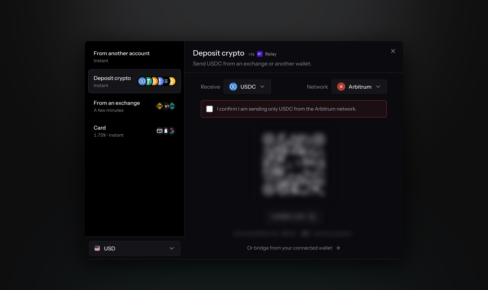

# Deposits and Withdrawals

<figure><figcaption></figcaption></figure>

Quote is non-custodial. Your funds sit in your own Hyperliquid account, and Quote never holds them. Everything below moves value between your wallet, other chains, and the two balances Hyperliquid keeps for you.

There are four flows in the terminal, and they do different jobs:

| Flow         | Moves funds                                    | Use it to                          |
| ------------ | ---------------------------------------------- | ---------------------------------- |
| **Deposit**  | A wallet, an exchange, a card or bank, or another of your accounts → your Hyperliquid balance | Fund your account to start trading |
| **Withdraw** | Your Hyperliquid balance → a wallet on another chain, HyperEVM, or another Hyperliquid address | Take money off the venue |
| **Transfer** | Spot balance ↔ perps balance                   | Rebalance inside Hyperliquid       |
| **Send**     | Your Hyperliquid balance → another address     | Pay someone directly in USDC       |

## Deposit

Click **Deposit** to open the deposit window. The methods are listed on the left, and the one you pick opens beside them. Which methods you see depends on your account and on where you are, and each row shows how quickly it arrives and, for a purchase, its fee.

| Method                    | What it does                                                                                   |
| ------------------------- | ---------------------------------------------------------------------------------------------- |
| **From another account**  | Moves USDC from another of your [accounts](subaccounts.md). Shown only if you have more than one. |
| **Deposit crypto**        | Gives you an address to send to, from your own wallet or from an exchange.                    |
| **From an exchange**      | Pulls USDC from an exchange account you connect, where available.                             |
| **Card, bank and local methods** | Buys USDC with money, using the methods offered in your country and currency.          |

### Deposit crypto

Choose what you are sending under **Receive** and the chain it is on under **Network**.

* **USDC** from Arbitrum, Ethereum, Base and the other EVM chains Relay supports goes through Relay and lands as USDC in your Hyperliquid perps balance. The panel shows Relay's estimated fee before you send.
* **BTC, ETH, SOL, AVAX and XPL** can be sent natively on their own chains through Unit. They arrive as that asset in your Hyperliquid spot balance, and each has a minimum.
* **Tokens on HyperEVM** move into your trading balance through Hyperliquid itself, with no bridge.
* **HyperCore** shows your account's Hyperliquid address, for funds another wallet or an exchange sends you on Hyperliquid.

Tick the box confirming the asset and network before the address appears. If you signed in with a wallet, **Or bridge from your connected wallet** bridges from it directly instead: enter an amount and the terminal fetches a live quote before you sign. Check what will arrive rather than assuming you receive what you sent, because bridging a small amount can cost a meaningful share of it in fees.


Send only the asset you selected, on the network you selected. Deposits of other assets, or from other networks, can be lost, and recovering them is a manual wallet operation you have to perform yourself.


### Card, bank and local payment methods

Pick your currency at the bottom of the method list. The window then shows the card, bank and local methods (PIX in Brazil, for example) available for that currency in your country. You complete the payment inside the window (some methods open a new tab), and the USDC is delivered to your account. Track it under **Transactions**.

The percentage on each row is the provider's processing fee. The rate you are quoted also includes the provider's spread, so check the USDC amount before you pay.

Where those methods are not offered, the window can fall back to **Credit card** and **Bank transfer**. A card purchase there arrives as USDC on Arbitrum: an embedded Quote wallet moves it to Hyperliquid automatically, while from your own wallet you bridge it under **Deposit crypto**. A bank transfer takes 1 to 3 business days and needs a one-time ID check.

### Where a deposit goes if you are already in a position

A deposit credits your perps balance, but that does not always mean it is available to trade. If you hold cross-margin positions with negative unrealized PnL, incoming funds are absorbed as collateral for those positions first. Your available balance can therefore rise by less than you deposited, or not at all.

This is Hyperliquid margin behavior, not a Quote rule, and it is the single most common reason a deposit looks like it went missing. See [Margin](../concepts/margin.md).

## Withdraw

Click **Withdraw** and choose **To a wallet**. Pick the coin under **Withdraw** and the network it should leave on. The network decides how the money travels:

* **USDC**, through Relay, to a wallet on another chain. Choose the chain and token it should arrive as, and the terminal quotes what will arrive before you sign.
* **BTC, ETH, SOL, AVAX and XPL**, natively through Unit, to your address on that coin's own chain. Unit sets its own minimum and network fee, so very small amounts may not be processed.
* **HyperCore**: sends the coin to another address on Hyperliquid, such as an exchange's deposit address. It stays on the venue.
* **HyperEVM**: moves a token that has a HyperEVM counterpart from your Hyperliquid balance to the same address on HyperEVM. It needs a wallet that can sign on HyperEVM.

A USDC withdrawal also asks **which balance the money comes from**:

* **Perps**: your cross-margin balance. Only the withdrawable portion is available, so collateral backing open positions is excluded.
* **Spot**: your spot USDC balance.


Check the destination address character by character. For a native withdrawal, confirm that the address is yours on that chain: some chains carry no checksum, so a typo cannot always be caught, and funds sent to the wrong address cannot be recovered.


## Transfer between spot and perps

Transfer moves USDC between your Hyperliquid spot and perps balances. Nothing leaves the venue and no bridge is involved, so it settles immediately.

You need this whenever a balance is in the wrong place: spot trading draws on the spot balance, perp margin draws on the perps balance.

Over the API this is `POST /api/positions/transfer`, which requires the `positions:write` scope. See the [Trader API reference](../api-reference/endpoints/positions.md).

## Send

Send transfers USDC from your Hyperliquid balance directly to another address on Hyperliquid. It is a payment, not a withdrawal: the funds stay on the venue and arrive in the recipient's account.


Check the destination address before confirming. Sends are irreversible, and an address typo cannot be undone by Quote or by Hyperliquid.



On a [unified or portfolio-margin account](../concepts/margin.md#unified-accounts), the spot-versus-perps split above stops describing how your collateral actually works. Quote detects the mode and adapts these flows, but treat the balance split as a display convenience rather than the underlying truth.


## If a deposit or transfer looks wrong

Usually the funds went to collateral, the amount fell under a route minimum, or the wrong token or chain was used. [Deposit or transfer issues](../support/deposit-or-transfer-issues.md) works through each case.
