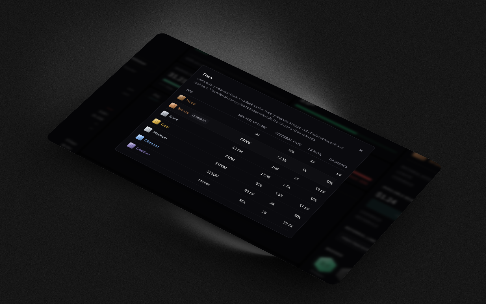

# Fees

<figure><figcaption></figcaption></figure>

Every fill you make carries three layers of cost. The terminal shows the assembled figure, but it is worth understanding what goes into it, because two of the three layers move with your own activity.

| Layer             | Who charges it | Direction    |
| ----------------- | -------------- | ------------ |
| Hyperliquid fee   | The venue      | You pay      |
| Quote builder fee | Quote          | You pay      |
| Rewards rebates   | Quote          | You get back |

## Hyperliquid fees

Hyperliquid charges separate taker and maker rates for perps and for spot. Your rate is not fixed. It moves with:

* **Your volume tier.** Hyperliquid steps your rate down as your traded volume rises. The ladder is the venue's, not Quote's.
* **A HYPE staking discount**, expressed as a percentage off your Hyperliquid fees.
* **A referral discount**, if a Hyperliquid referral applies to your account.

Quote reads your net rate after all three, so what you see is the rate you actually pay rather than the published base rate.


Hyperliquid's staking levels share names with Quote's [rewards tiers](rewards-tiers.md), and they are unrelated. A staking level changes what the venue charges you. A Quote tier changes what Quote rebates you. Quote deliberately never names the staking level for this reason.


## The Quote builder fee

Quote earns through Hyperliquid's builder-code mechanism rather than through subscriptions or spread markup. Every Quote-routed order carries Quote's builder code, and the fee is attached server-side.

The rate is **2 bps (0.02%) on perpetuals and 4 bps (0.04%) on spot sells**. A spot buy pays no builder fee: Hyperliquid collects builder fees in USDC, which a spot buy never yields. The fee is charged only on filled orders. There are no fixed subscriptions and no monthly minimums: if you do not trade, you pay Quote nothing. The rate sits on top of [Hyperliquid's own fees](https://hyperliquid.gitbook.io/hyperliquid-docs/trading/fees), as the builder-code design intends.

Your wallet has to approve the builder fee on Hyperliquid before Quote will trade for it. Approval is a one-time signature when you [enable trading](../concepts/agent-wallets.md#setting-it-up).

The builder fee is never hidden. The order form's cost breakdown shows it as **Builder fee**, and each [algo order's page](../guides/analytics.md#an-algo-orders-page) reports it separately from the venue's fee, so you can always see Quote's share of what a fill cost.

## Rebates

Two rebates act on your own fees, both from the rewards program:

* **Cashback**, a percentage of your own fees returned to you, set by your [rewards tier](rewards-tiers.md).
* **The invited-user rebate**, a flat rate that applies while you were referred by a real referrer and your volume is under the program cap.


Rebates accrue as claimable USDC. They do not reduce the fee charged on-chain. A fill still costs the Hyperliquid fee plus the builder fee at the moment it happens, and the rebate arrives separately, to be claimed. See [Referrals](referrals.md) for claiming.


Anything you earn from other people's trading, as a referrer, is not part of this. That lives in the referral program.

## Your effective rate

The all-in rate is the Hyperliquid fee plus the builder fee, minus what rewards hand back. The terminal computes this server-side so that every surface showing you a fee number is showing the same number.

To see your current stack, click **Fees (Taker / Maker):** in the order details of the order form. The **Fee Schedule** shows your net Hyperliquid taker and maker rates for perps and spot, your Hyperliquid volume tier and the volume that would reach the next one, your HYPE staking and Hyperliquid referral discounts, the builder fee for perps and spot and whether it is being charged, and your cashback and invite rebate.

To read the fees you have already paid over the API, see the [Analytics endpoints](../api-reference/endpoints/analytics.md).
