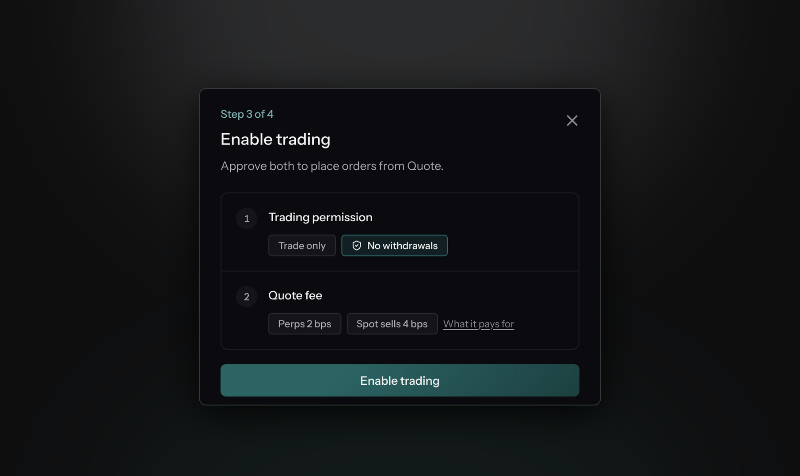

# Agent Wallets

<figure><figcaption></figcaption></figure>

Quote is **non-custodial**. It never holds your keys or your funds. Instead, trading happens through Hyperliquid's native agent-wallet mechanism: a separate secp256k1 key that can _sign orders_ for your account but can **never withdraw**.

## The model

|                         | Main wallet (yours)                 | Agent wallet (Quote-managed)                                                        |
| ----------------------- | ----------------------------------- | ----------------------------------------------------------------------------------- |
| Holds funds             | ✅                                   | ❌                                                                                   |
| Can withdraw            | ✅                                   | ❌                                                                                   |
| Can place/cancel orders | ✅                                   | ✅ (after you approve it)                                                            |
| Key location            | Your wallet / Privy embedded wallet | Generated by Quote, encrypted at rest (XChaCha20-Poly1305) in an isolated key vault |

You authorize the agent **once**, by signing an approval with your main wallet. From then on, Quote signs orders with the agent key. That is why algo strategies can work an order for hours without asking you to sign every child slice.

## What the agent can and cannot do

| The agent wallet can                         | The agent wallet cannot           |
| -------------------------------------------- | --------------------------------- |
| Trade perpetuals, against your perps balance | Withdraw funds                    |
| Trade spot, against your spot balance        | Transfer funds out                |
| Swap spot tokens                             | Deposit, via Arbitrum or HyperEVM |
|                                              | Transact on HyperEVM              |

The permissions are enforced by Hyperliquid, not by Quote, which is what makes the guarantee worth something: a leaked [API key](../guides/api-keys.md) can trade within the permissions you gave it, but cannot move your money anywhere you did not authorize.

## Setting it up

You set up the agent once, from the terminal. The setup checklist calls this step **Enable trading**, and the order form shows an **Enable Trading** button until it is done. Your wallet needs a balance first: the terminal asks you to deposit before you can enable trading.



#### Create the agent

Quote generates a fresh agent key. The private key is encrypted at rest and never leaves Quote's key vault.



#### Approve the trading permission

Your main wallet signs Hyperliquid's `approveAgent` action for the new agent. The terminal shows this as **Trading permission**: **Trade only**, **No withdrawals**.

Hyperliquid replaces a wallet's existing agent of the same name, so approving again swaps the old agent out.



#### Approve the Quote fee

Every order routed through Quote carries Quote's [builder fee](../account/fees.md#the-quote-builder-fee), and **Quote requires the approval before it will trade for your wallet**. Your main wallet signs Hyperliquid's `approveBuilderFee` action once. The terminal shows this as **Quote fee**. Until it is done, every order fails, whether placed from the terminal or the API.



#### Trade

Every order resolves your wallet's current agent, checks with Hyperliquid that it is still registered to your wallet, and signs with it.



Your wallet asks you to sign twice, once for each approval. If one is already in place, it asks once.


Both approvals need a signature from your **main wallet**, which only the terminal can produce. An API key cannot set up an agent, so complete this step in the [terminal](https://quotemarkets.xyz) before you automate anything. To check an agent's status over the API, see the [API Quickstart](../quickstart.md).


## Signing flow

When Quote signs an action on your behalf, it:

1. Decrypts the agent private key (XChaCha20-Poly1305 authenticated encryption).
2. Computes the EIP-712 typed-data hash of the Hyperliquid action.
3. Signs it with secp256k1.
4. Erases the key material from memory.

Before signing, Quote checks with Hyperliquid that the agent is still registered **and belongs to your wallet**. A stale or revoked agent fails closed: nothing is signed.

## Expiry and revoking

Hyperliquid agents can expire. If yours has, the terminal asks you to enable trading again.

You can revoke an agent at any time directly on Hyperliquid (it is your account). Quote fails closed: a revoked agent cannot sign, and order submission returns an error rather than falling back to anything else.
