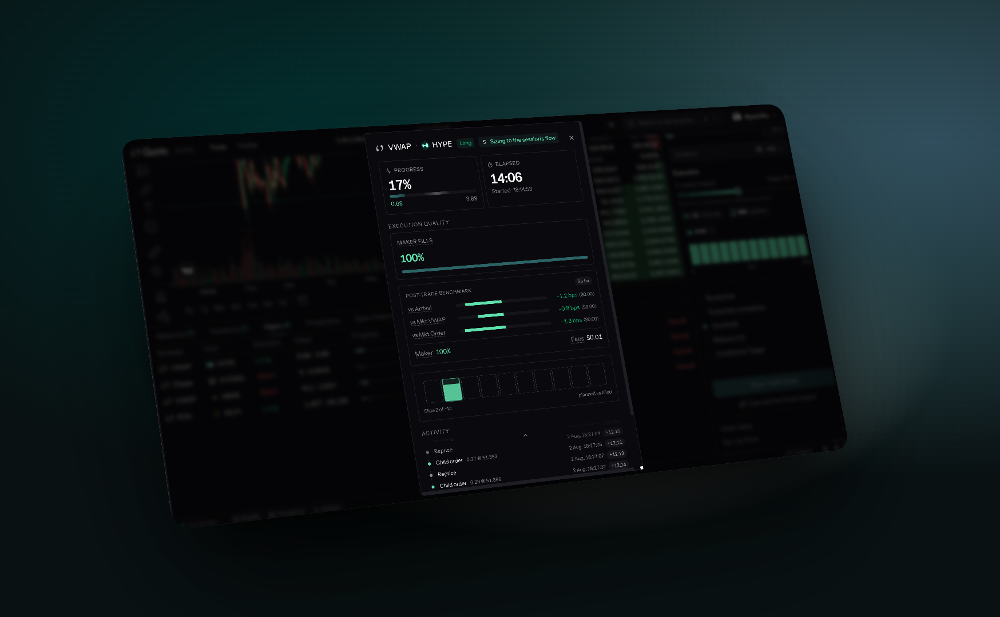

# Analytics

<figure><figcaption></figcaption></figure>

Quote measures every execution so you can hold the engine, and yourself, to account. You find the results in two places: each algo order's own page, and the analytics panel on your profile.

## The benchmark convention

All benchmark values are **signed basis points**:

* **Positive = worse**: you paid more (buys) or received less (sells) than the benchmark.
* **Negative = better**: you beat the benchmark.

Three benchmarks are computed for every algo order:

| Benchmark             | Question it answers                                                               |
| --------------------- | --------------------------------------------------------------------------------- |
| vs. **arrival price** | How far did price drift from when I decided to trade? (implementation shortfall) |
| vs. **market VWAP**   | Did I beat the average trade in the market during my window?                      |
| vs. **market order**  | What did working the order save me against sweeping the book at once?            |

The "vs. market order" benchmark (a simulated sweep of the book at each fill time) is the most actionable: it separates spread capture from market drift.

## An algo order's page

Open an order from the **Algos** tab of the positions panel to see its page. Alongside its progress, it shows:

* **Benchmarks**: your execution VWAP against **Arrival**, **Market VWAP** and **Market order**, in basis points and dollars. Where available, a TWAP is also compared with Hyperliquid's own native TWAP (**HL native TWAP**).
* **Slippage vs arrival** and **Fees**, with the fee split into the venue's share and Quote's **Builder fee**.
* **Execution vs plan**: cumulative fills against the planned trajectory.
* **Markouts**: how the mid moved 1, 5 and 30 seconds after your fills. Here positive means the price moved in your favor. The **Maker only** view isolates resting fills, where persistently negative markouts mean your resting orders are being picked off.
* **Cost to finish now**: what sweeping the live book for the unfilled remainder would cost.

## Your profile

The analytics panel on your profile has four views:

* **PnL**: your account value over time, shown as **Equity** or **PnL**, for perps alone or for all assets.
* **Calendar**: profit and loss by day.
* **Funding**: funding paid and received. Funding is synced from Hyperliquid into a per-wallet record.
* **Heatmap**: your positions at a glance.

Deposits and withdrawals change your account value without being performance, so profit and loss is measured net of them.

## Over the API and MCP

The same figures are available over the API: see the [Analytics](../api-reference/endpoints/analytics.md), [Funding](../api-reference/endpoints/funding.md) and [Portfolio](../api-reference/endpoints/portfolio.md) endpoints, and the [analytics conventions](../api-reference/introduction.md#analytics-conventions). They are also exposed as read-only tools over the [MCP connector](../mcp/overview.md), so an AI agent can pull your execution report or funding carry.
